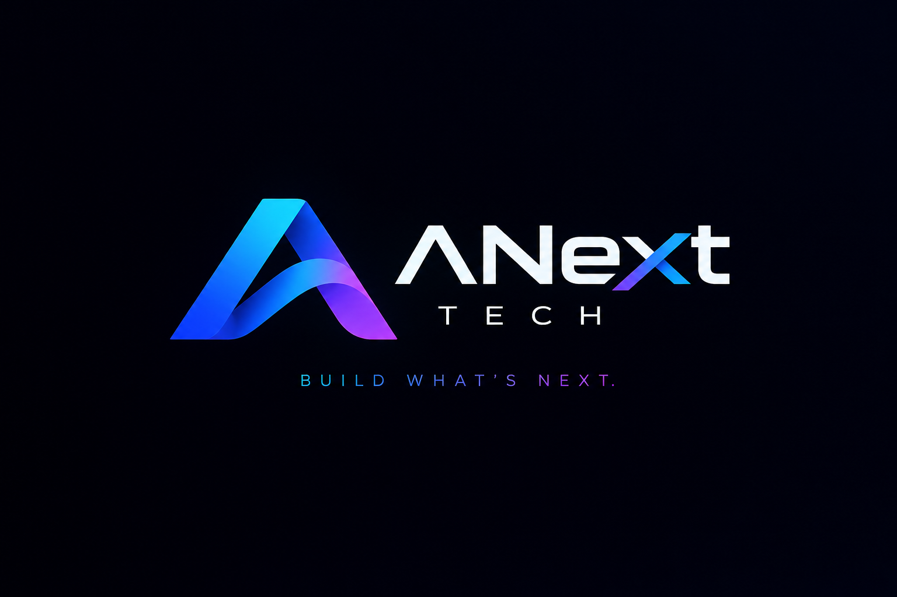

# 🚀 ANextTech — Build What's Next.

<p align="center">
  <strong>Tecnologia, software e soluções SaaS para transformar ideias em experiências digitais.</strong>
</p>

<p align="center">
  
</p>

<p align="center">
  
  
  
</p>

## 📌 Sobre o projeto

A **ANextTech** é um projeto de tecnologia com foco no desenvolvimento de software, aplicações web e soluções SaaS. Sua proposta é transformar ideias em produtos digitais modernos, funcionais e preparados para evoluir.

Este repositório contém a primeira versão da aplicação, desenvolvida com Python e FastAPI, incluindo uma página inicial personalizada com a identidade visual da marca e um endpoint para verificar o estado da API.

O projeto está sendo preparado para hospedagem em nuvem e futura expansão para diferentes dispositivos, incluindo computadores Linux e smartphones Android.

## 🎯 Objetivos

- Desenvolver uma presença digital profissional para a ANextTech.
- Construir aplicações web com arquitetura organizada.
- Aprender e aplicar boas práticas de desenvolvimento backend.
- Preparar a aplicação para publicação na nuvem.
- Evoluir a plataforma com novas funcionalidades e serviços SaaS.
- Explorar soluções multiplataforma com foco em acessibilidade e usabilidade.

## 🛠️ Tecnologias utilizadas

| Tecnologia | Finalidade |
|---|---|
| Python | Linguagem principal do backend |
| FastAPI | Construção da aplicação web e API |
| Uvicorn | Servidor ASGI para executar a aplicação |
| HTML5 | Estrutura da página inicial |
| CSS3 | Estilização e identidade visual |
| Git e GitHub | Versionamento e armazenamento do código |
| Render | Hospedagem em nuvem planejada |

## 📂 Estrutura do projeto

```text
ANextTech/
├── main.py
├── requirements.txt
├── .gitignore
├── README.md
└── static/
    └── images/
        └── logo.png
```

### Descrição dos arquivos

- `main.py`: aplicação FastAPI, página inicial e endpoint de saúde.
- `requirements.txt`: dependências Python necessárias para executar o projeto.
- `.gitignore`: arquivos e pastas que não devem ser enviados ao Git.
- `static/images/logo.png`: identidade visual da ANextTech.
- `README.md`: documentação do projeto.

## 💻 Como executar no Linux

### 1. Pré-requisitos

Instale Python 3, Git e o suporte a ambientes virtuais.

Em distribuições baseadas em Debian, Ubuntu ou compatíveis:

```bash
sudo apt update
sudo apt install python3 python3-venv python3-pip git
```

### 2. Clonar o repositório

```bash
git clone https://github.com/alexcorreia-jr/ANextTech.git
```

Entre na pasta:

```bash
cd ANextTech
```

### 3. Criar o ambiente virtual

```bash
python3 -m venv .venv
```

Ative o ambiente:

```bash
source .venv/bin/activate
```

### 4. Instalar as dependências

```bash
python -m pip install --upgrade pip
pip install -r requirements.txt
```

### 5. Iniciar a aplicação

```bash
uvicorn main:app --reload
```

Acesse no navegador:

- **Página inicial:** http://127.0.0.1:8000
- **Documentação interativa da API:** http://127.0.0.1:8000/docs
- **Documentação alternativa:** http://127.0.0.1:8000/redoc
- **Verificação de saúde:** http://127.0.0.1:8000/health

Para encerrar o servidor, pressione `Ctrl + C` no terminal.

## ☁️ Publicação na nuvem

O projeto está sendo preparado para publicação no Render.

Configuração prevista para o serviço:

| Campo | Configuração |
|---|---|
| Repositório | `alexcorreia-jr/ANextTech` |
| Branch | `main` |
| Ambiente | Python 3 |
| Build Command | `pip install -r requirements.txt` |
| Start Command | `uvicorn main:app --host 0.0.0.0 --port $PORT` |

Após a publicação bem-sucedida, o Render fornecerá um endereço HTTPS próprio.

**Importante:** o link público deverá ser adicionado a esta documentação depois que o deploy estiver concluído e o endereço for confirmado.

## 📱 Próximas funcionalidades

O desenvolvimento poderá seguir estas etapas:

- [x] Criar a página inicial da ANextTech.
- [x] Adicionar a identidade visual da marca.
- [x] Criar a API com FastAPI.
- [x] Criar o endpoint `/health`.
- [x] Publicar o código no GitHub.
- [ ] Concluir a publicação na nuvem.
- [ ] Configurar um aplicativo web instalável (PWA).
- [ ] Melhorar o suporte à utilização em dispositivos móveis.
- [ ] Desenvolver novas funcionalidades e serviços SaaS.
- [ ] Implementar banco de dados e autenticação quando necessários.

## 🔐 Segurança

- Não publique senhas, tokens ou chaves privadas no repositório.
- Utilize variáveis de ambiente para configurações sensíveis.
- Mantenha as dependências atualizadas.
- Configure autenticação e autorização antes de disponibilizar funcionalidades privadas.
- Não utilize dados pessoais ou informações de clientes sem autorização adequada.

## 👨‍💻 Desenvolvedor

**Alex Correia Jr.**

Estudante de Ciência da Computação, interessado em desenvolvimento backend, Python, APIs, soluções web e construção de produtos digitais.

### Minhas redes sociais

- **GitHub:** https://github.com/alexcorreia-jr
- **LinkedIn:** https://www.linkedin.com/in/alexcorreia-jr/
- **Instagram:** https://www.instagram.com/dev_alexlp/

## 📄 Licença

A licença do projeto ainda não foi definida. Uma licença deverá ser escolhida antes de autorizar formalmente a reutilização, modificação ou distribuição do código por terceiros.

---

<p align="center">
  <strong>ANextTech — Build What's Next.</strong>
  <br>
  Transformando ideias em possibilidades digitais.
</p>
